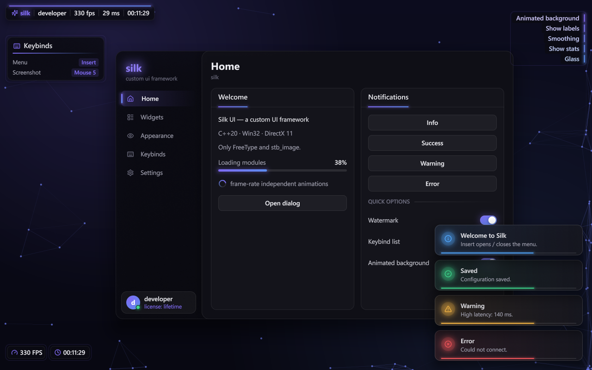
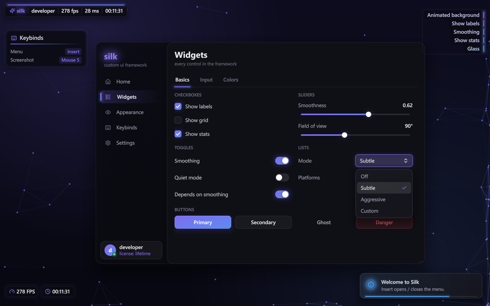
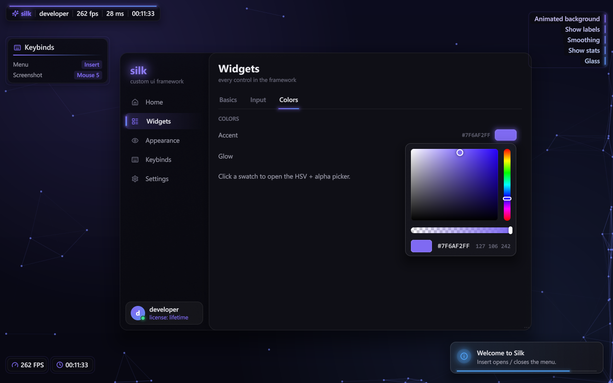
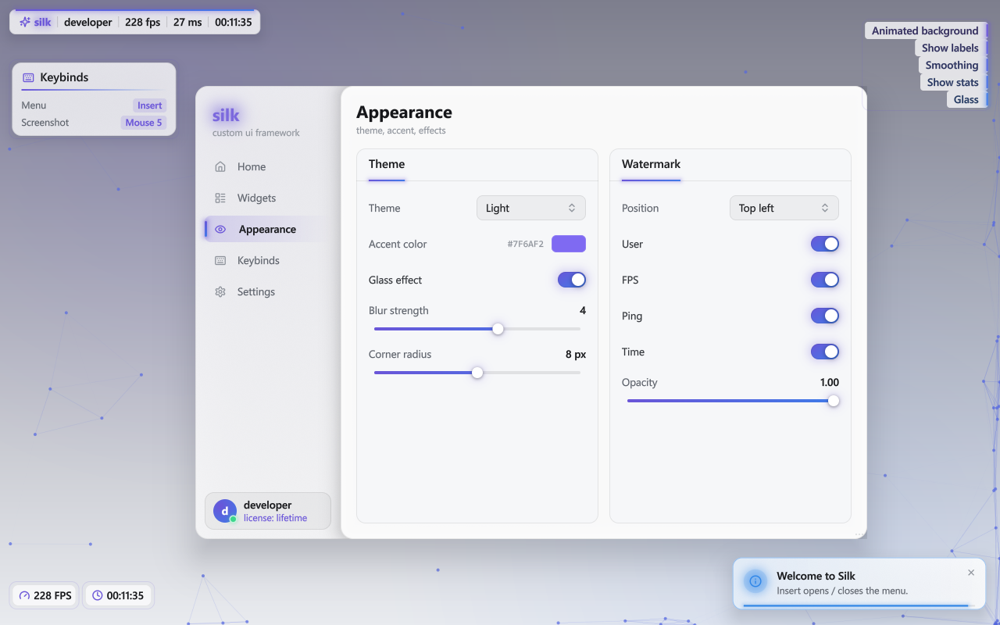
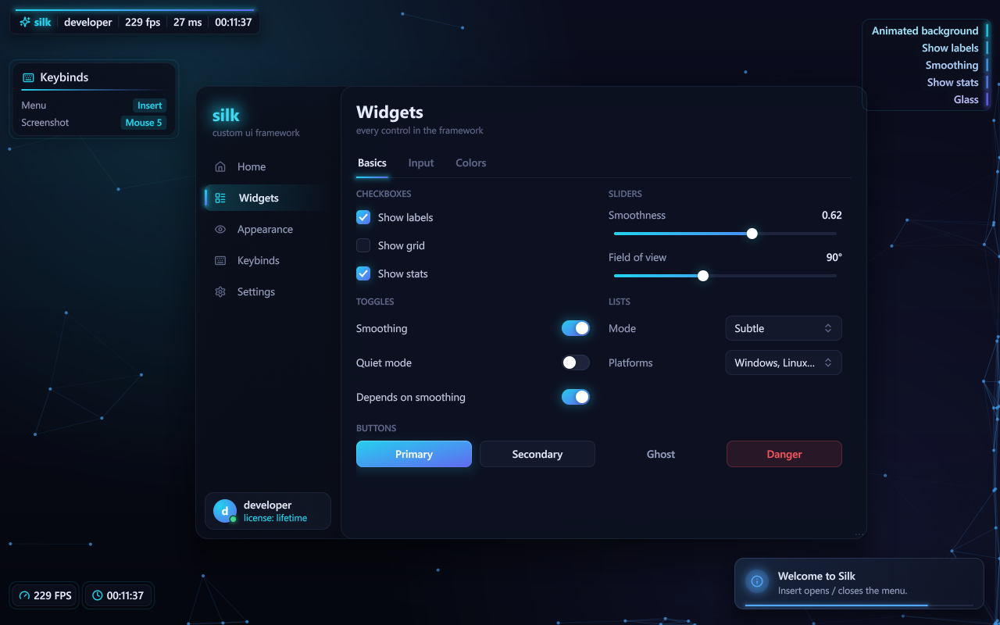
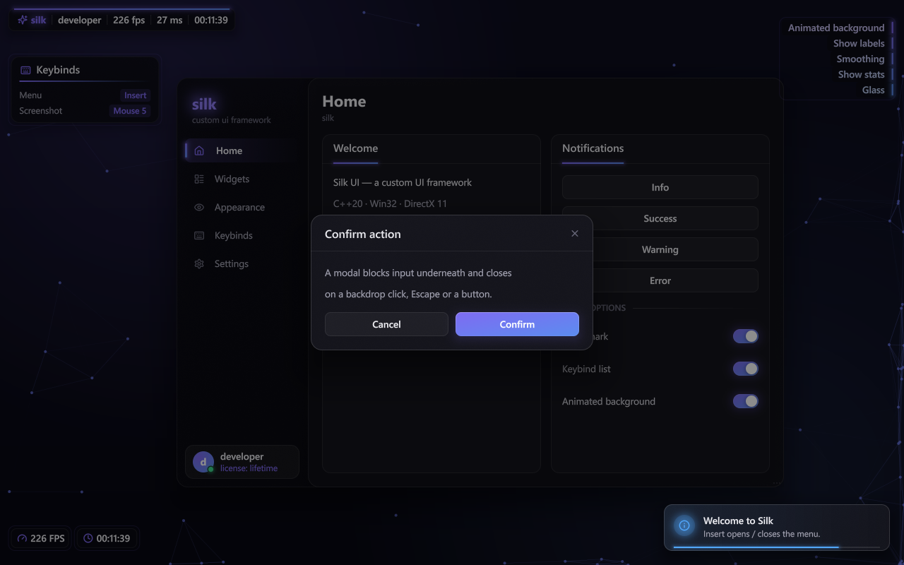
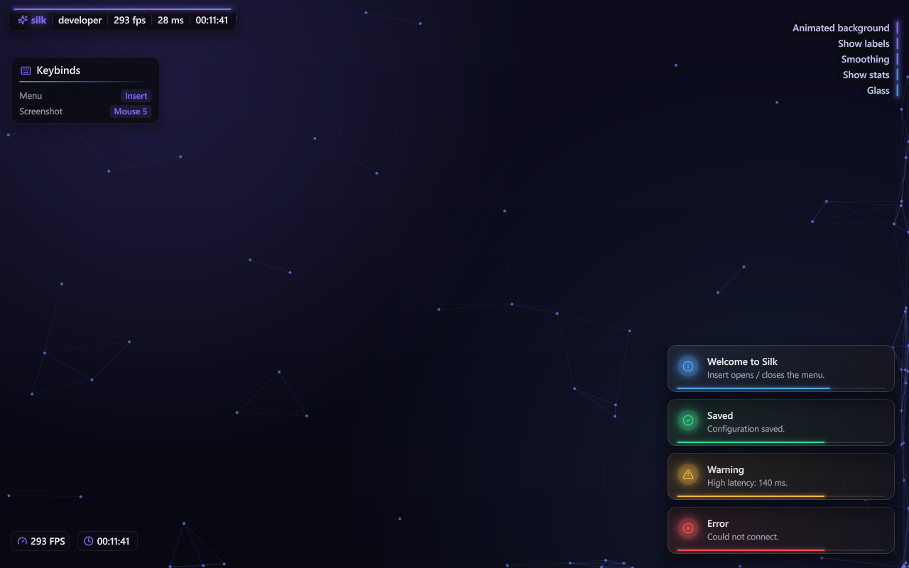

<div align="center">

# Silk UI

**A modern immediate-mode UI framework for C++20 and DirectX 11, built from scratch.**

SDF rendering · spring physics · frosted glass · HUD & toasts · transparent overlay mode

[](https://github.com/qwnicc/silk-dx11-ui/actions/workflows/build.yml)


[](LICENSE)



</div>

---

Silk takes the immediate-mode API style of Dear ImGui and gives it the look and feel of a modern
desktop app such as Linear, Raycast or macOS. Every pixel comes from its own batch renderer and
HLSL shaders. It does not depend on ImGui, Nuklear or any other UI library. The only external
code is **FreeType** and **stb_image**.

```cpp
if (ui::Begin("Settings", &open)) {
    ui::Toggle("Enable glow", &glow);
    ui::SliderFloat("Radius", &radius, 0, 32, "%.0f px");
    if (ui::Button("Apply", ui::ButtonVariant::Primary))
        silk::Notify::Push(silk::Notify::Type::Success, "Applied", "Settings saved.");
}
ui::End();
```

## Highlights

- **Crisp at any size.** Rounded rectangles, strokes, capsules, circles, shadows and glows are
  analytic signed distance fields evaluated per pixel, with no tessellation and no jagged corners.
  Text uses FreeType SDF glyphs with kerning and full Unicode.
- **Everything animates.** Hover, press, focus and enabled states, checkmarks, toggles, tab
  indicators, popups, windows and toasts all move on tweens or real spring physics. The motion is
  frame-rate independent, so it looks the same at 60 and 240 FPS.
- **Frosted glass.** Windows, popups, modals and toasts can blur what's behind them using a
  dual-Kawase backdrop blur.
- **HUD layer.** A module list sorted by width with animated entry and exit, an FPS counter, a
  clock and a keybind panel. Elements can be dragged while the menu is open, and their positions
  are saved to JSON.
- **Toasts.** `Notify::Push(type, title, message, duration)` slides a notification in on a spring
  and shows a lifetime bar. The timer pauses on hover, a click dismisses it, and the rest of the
  stack re-flows.
- **Watermark.** A segmented bar (logo · name · user · FPS · ping · time) whose width animates when
  its text changes. Position, visible fields and opacity are configurable.
- **Runtime theming.** `Theme` holds colors, radii, spacing and typography. Dark, Midnight and
  Light presets are included, and switching themes cross-fades every color.
- **Overlay mode.** A transparent, always-on-top window over other apps. Clicks outside the UI
  fall through to whatever is underneath.

## Gallery

| | |
|:---:|:---:|
| <br>Widgets & dropdown | <br>HSV + alpha color picker |
| <br>Light theme | <br>Midnight theme |
| <br>Modal with backdrop blur | <br>HUD, watermark & toasts (menu closed) |

## Widgets

| Category | Widgets |
|---|---|
| Containers | `Begin/End` window (drag, resize, open/close animation), `BeginSidebar` + `SidebarItem` (sliding indicator), `SidebarHeader`, `SidebarUser`, `BeginCard`, `BeginChild` (inertial scrolling with spring overscroll), `BeginModal`, `Tabs` + `BeginTabContent` (fade + slide) |
| Controls | `Button` (primary / secondary / ghost / danger), `IconButton`, `Checkbox` (drawn-on checkmark), `Toggle` (spring knob with press stretch), `SliderFloat` / `SliderInt` (value bubble), `Combo`, `MultiSelect`, `ColorEdit` (HSV + alpha), `Keybind` (keyboard and mouse buttons), `InputText` / `InputField` (caret, selection, clipboard, word jumps, horizontal scroll) |
| Display | `Text`, `TextDim`, `Heading`, `Title`, `Caption`, `PageHeader`, `Icon("settings")` (Lucide, 1,500+ icons), `Separator`, `ProgressBar`, `Spinner`, `Tooltip` |
| Layout | `BeginRow`, `BeginColumns(n)`, `BeginColumn`, gap / padding / align / justify, fill-remaining sizing, `Spacing` |
| State | `BeginDisabled` (animated), `PushID` / `PopID`, `"Label##id"` hidden IDs |

## Getting started

Requirements: Windows 10/11 and Visual Studio 2022 or newer (MSVC with C++20) with the bundled CMake.

```powershell
git clone https://github.com/qwnicc/silk-dx11-ui.git
cd silk-dx11-ui
./build.ps1                      # or: cmake -S . -B build -A x64 && cmake --build build --config Release
build/bin/Release/silk_demo.exe
```

**Insert** toggles the menu. While it is open you can drag the HUD elements around. Settings are
saved to `silk_config.json` next to the executable.

| Demo flag | Effect |
|---|---|
| `--overlay` | Transparent, always-on-top overlay over other apps (**End** quits) |
| `--novsync` | Present without vsync |
| `--size 1280x800` | Initial client size in logical pixels |
| `--shot out.png --frames 60 --script "page=1;click=1000,420@20"` | Render N frames with scripted input and save a PNG (handy for CI and docs) |

## Integration

Silk never clears the render target. It draws its widgets on top of whatever is already there.

```cpp
silk::Context ui;
ui.Init(device, deviceContext, "assets");     // compiles shaders, loads fonts

// WndProc
if (ui.HandleMessage(hwnd, msg, wParam, lParam)) return 0;   // true = UI consumed the input

// every frame, after your scene was rendered into rtv
ui.NewFrame(width, height, dpiScale);
/* ... widgets ... */
hud.Draw(ui);
silk::Notify::Draw();
ui.Render(rtv);
swapChain->Present(1, 0);
```

`ui.In().wantCaptureMouse` and `wantCaptureKeyboard` tell your app when the input belongs to the UI.

### Transparent overlay

[`demo/main.cpp`](demo/main.cpp) shows the full setup:

- a `WS_POPUP` window with `WS_EX_NOREDIRECTIONBITMAP | WS_EX_TOPMOST`,
- a swap chain created with `CreateSwapChainForComposition` and `DXGI_ALPHA_MODE_PREMULTIPLIED`,
  bound to a DirectComposition visual,
- a clear to `{0, 0, 0, 0}` every frame,
- `WS_EX_LAYERED | WS_EX_TRANSPARENT` switched on whenever the cursor is not over a Silk layer,
- frame pacing with `DwmFlush`.

Silk's blending already writes premultiplied color into a transparent target, so the renderer
needs no changes for this mode.

## Architecture

```
src/silk/
├── core/      math (Vec2, Rect, Color, HSV), FNV-1a IDs, Win32 input, clock, UTF-8
├── render/    DrawList batching, DX11 renderer, HLSL SDF shaders, FreeType SDF fonts, PNG capture
├── anim/      AnimStore (float / Vec2 / Color per widget ID), easings, Spring
├── theme/     Theme + ThemeManager (animated transitions)
├── layout/    flex-style row/column stack with retained measurements
├── widgets/   Context (layers, hover, popups, tooltips) + the public ui:: API
├── hud/       Hud elements + watermark
├── notify/    toast notifications
└── config/    tiny JSON value / parser / writer
```

**Hybrid immediate mode.** The API is immediate: you call widgets every frame and read results
directly. Silk keeps retained state behind the scenes, keyed by hashed IDs: animation tracks,
window positions, scroll physics, text editing and popup lifetimes. Sizes that are only known after
layout, such as row widths for justification or a card's content height, come from the previous
frame.

**Layers.** Every window, popup, modal, toast stack, HUD element and tooltip is a layer with its own
draw list. Hover is resolved against the previous frame's layer rectangles, top-most first, so
widgets under a popup never react. Layers are z-sorted when the frame is submitted.

**Rendering.** All primitives share one vertex format, and the pixel shader branches on a
per-vertex shape type. Shapes don't sample textures, so they merge into the current command. A new
draw call starts only when the texture or clip rect changes, or when a backdrop blur is requested.
The demo's full menu with HUD and toasts renders in a handful of draw calls.

**Animation.** `Motion::Tween(seconds, Ease::OutExpo)`, `Motion::Springy({stiffness, damping, mass})`
and `Motion::Smooth(rate)` cover the motion models. Springs integrate with semi-implicit Euler at a
fixed 1/960 s sub-step, which is why the curve is identical at any frame rate.

**DPI.** Widgets work in logical pixels. The renderer scales geometry and scissor rects by the
monitor's DPI, and SDF text stays sharp at every scale.

## Theming

```cpp
silk::Theme t = silk::Theme::Dark();
t.accent  = silk::Color::Hex(0x22D3EE);
t.accent2 = silk::Color::Hex(0x6366F1);   // gradient end
t.radius  = 10.0f;
ui.Themes().Set(t);                       // cross-fades over ~0.45 s
```

## Third-party

| Library | License | Use |
|---|---|---|
| [FreeType](https://freetype.org) 2.13.3 | FTL (BSD-style) | glyph rasterization, SDF renderer |
| [stb_image](https://github.com/nothings/stb) | Public domain / MIT | PNG/JPEG loading |
| [Lucide](https://lucide.dev) 0.460.0 | ISC | icon font |

See [THIRD_PARTY_NOTICES.md](THIRD_PARTY_NOTICES.md). The UI fonts (Segoe UI, Consolas) come from
Windows and are not redistributed. Drop `Inter-*.ttf` or `JetBrainsMono-Regular.ttf` into
`assets/fonts/` to use those fonts instead.

## License

[MIT](LICENSE) © piorr
